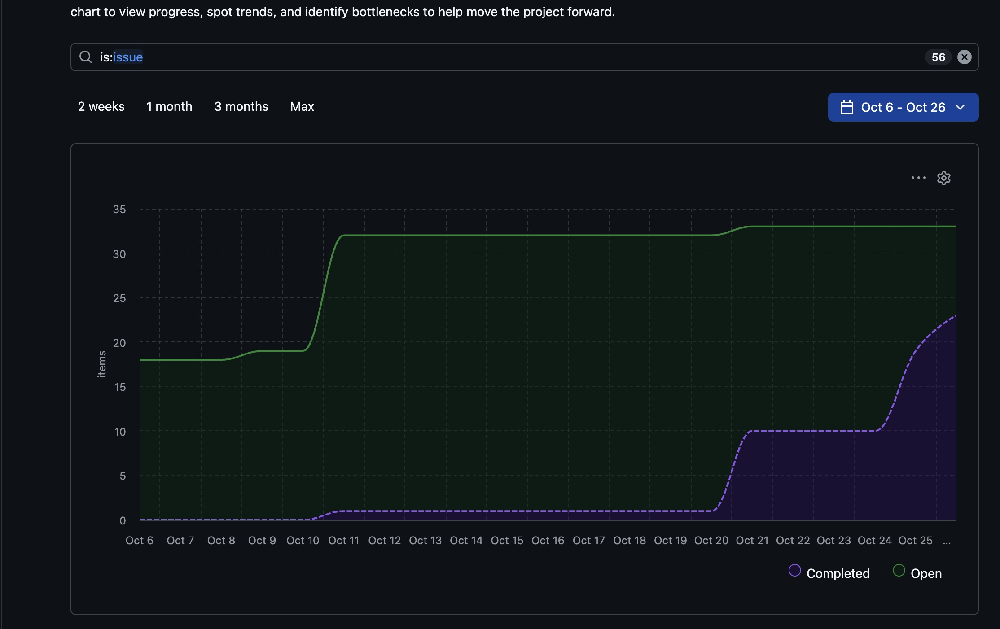

# Team Uno — Sprint 3 Reflection

Team size: 5

## Overall Progress

This sprint, we worked on getting the different parts of our game to interact. In Sprint 2, we had the objects and animations, but a lot of the collisions were not connected yet. This sprint, we added more block collisions, item pickups, enemy movement, and projectile behavior.

For the mid-sprint check-in, our feedback said we met two-thirds of the expected requirements and made good progress on collisions. The scrolling camera and most of the flagpole animation were also listed as extra features. At that point, we still needed item spawning from question blocks, another area reached through a pipe, fireball/block collisions, and a way to show when Mario has star power. Now, main has all those features, along with stomping, enemy damage, Koopa shells, and a coin/life display. The game now has more connected gameplay instead of separate examples.

## Burndown Chart and Task Progress

The board chart covers October 6–26 and shows open and completed issues. It shows when the board changed but not exactly how much time each task took.

The open count starts at about 18, increases to about 32 around October 10–11, and reaches about 33 later in the sprint. More issues were being tracked as open after the sprint had already started. This is a reason to set up more of our tasks earlier and keep track of any added work.

The completed count stays near 1 for much of the middle of the sprint, then rises to about 10 around October 20–21 and about 23 by October 26. This implies that some work may have finished together, or that the team updates the board later like a checklist.

For the next sprint, we should add tasks earlier, break larger tasks into smaller ones, and update the board as we finish work instead of just at the end. We should also leave more time to connect and test everyone's code before the deadline.

## What Worked Well

Having one collision system with separate handlers helped us split up the work. We created an Excel sheet with each task explained throughly and kept checking progress on there. The way we chose to split up the work worked well, because each person could work on their assigned collisions and use the existing methods on the game objects. Pulling changes from main and using local testing helped us catch things that needed to work across different people's code. Playing the game also helped us notice problems like Mario getting stuck at the floor gap and around a pipe.

## What Was Difficult

Our initial meeting was the most time consuming as we had to decide how to divide up and handle the work without worrying about overwriting of code or adding the same implementation twice. We met and created drawings of how we wanted to approach the collision system, and then were able to agree, divide up the tasks, and ensure each of us could work on it and connect it all in our own time without merge conflicts. The initial decisions were difficult, but ended up making the rest of the Sprint run smoothly.

## What We Can Do Next Sprint

We should coninue to take time to agree on how shared tasks connect before we start writing them. Also, if someone takes over part of another person's task, we should tell the team and update the board so we do not both work on the same thing. Another thing is that we should merge smaller changes more often and test them in the actual game. Our team also wants to improve at doing code reviews earlier so there is time to make changes before the deadline. For next sprint, we also need to keep our tasks updated because the chart shows that our board needs more regular updates so we can see remaining work earlier, instead of using it mainly as a checklist at the end.
