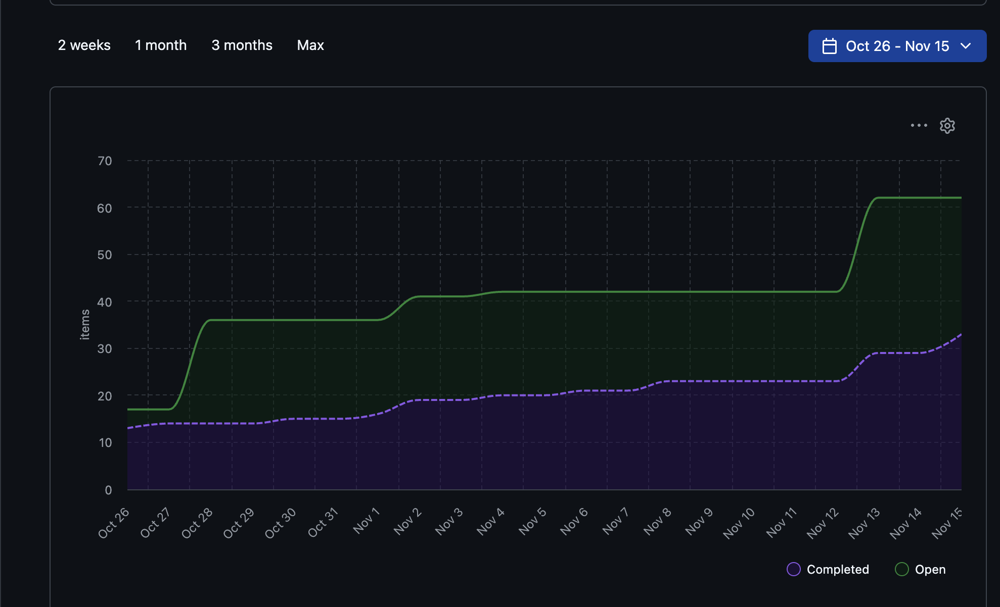

# Team Uno — Sprint 4 Reflection

Team size: 5

## Overall Progress

This sprint, we worked on finishing more of the game and fixing problems from Sprint 3. We added music and sound effects, HUD information, pause and menu controls, and better testing rooms. We also worked on game-over and restart behavior, Mario and fireball fixes, block sizing, and swimming, which all helped to make the game feel more complete.

## Burndown Chart and Task Progress

The chart covers October 26–November 15. Sprint 3 ended on October 26th so the beginning of this chart includes some tasks from Sprint 3.

The open count starts at about 17 and rises to 36 around October 28. It reaches 42 by November 4 and stays there until around November 12. It then rises to 62 around November 13. This shows that more open work was being tracked during the sprint, but the spike to 62 on November 13th was after we received feedback on what files need to be refactored, and what we would like to do for Sprint 5.

The completed count starts at about 13 and reaches about 23 by November 8. It stays flat for a few days, then rises to about 33 by November 15. We had more completion updates throughout the sprint than last time, but there were still gaps and then lots of tasks marked complete together. We should keep updating the board as we finish work and keep next sprint's tasks separate so it is easier to see what is left.

## What Worked Well

Splitting the work by features helped give everyone a clear idea of what to do. The testing rooms also helped us check items, enemies, blocks, and other behavior without playing through the whole level. A;Also, testing everyone's changes together helped us find problems that did not show up when we were working on separate branches.

## What Was Difficult

Some of our tasks needed changes in the same files even though we had different assignments. The menu, player, display, and restart behavior all connect, so we had to make sure merging did not remove someone else's changes. Time management was also a bit difficult, as a team some of us took more time to implement changes than others, but we still had to make sure to test everyone's changes and implementations and had to make sure we had enough time for that.

## What We Can Do Next Sprint

We should keep discussing how shared tasks connect before we start coding. If we need to change a file someone else is working on, we should note that down earlier. We should also merge smaller changes more often, test after merging, and do code reviews earlier so there is time to make changes. Keeping the board updated throughout the sprint would also help us see our progress more clearly.
